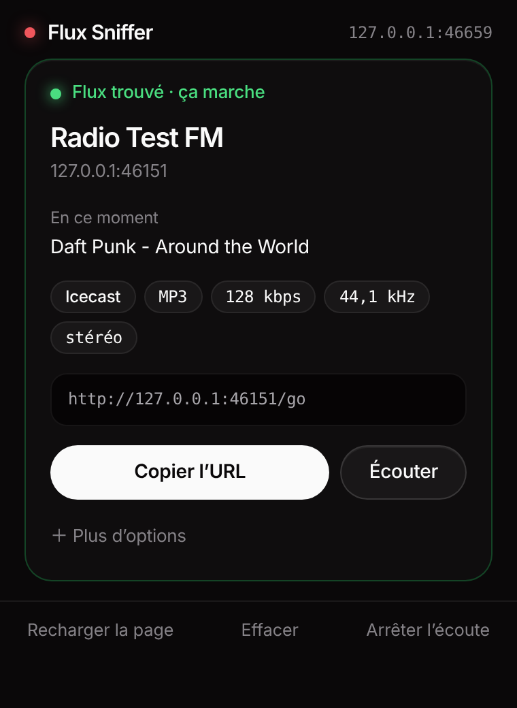
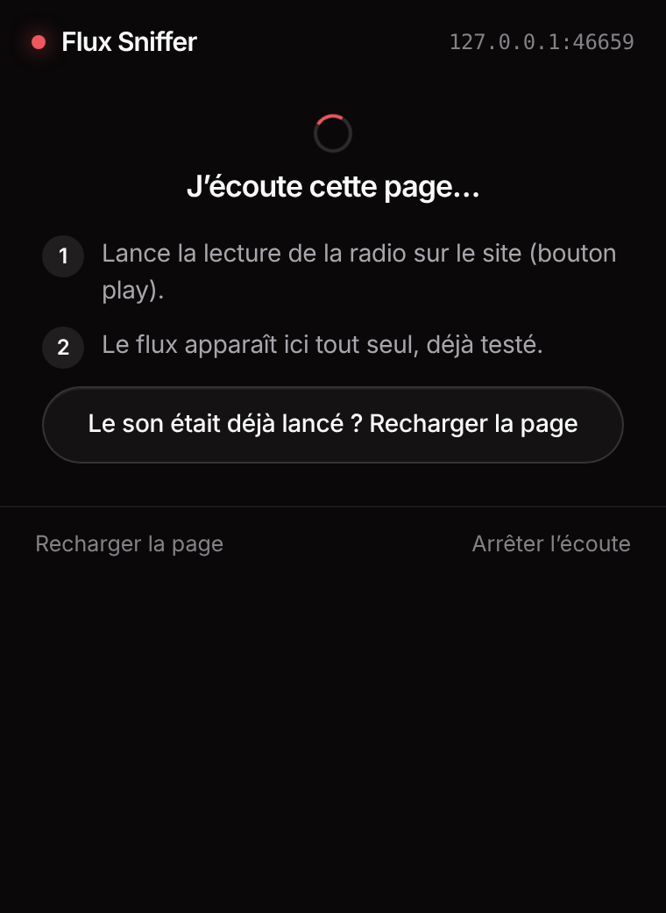

<p align="center"></p>

<h1 align="center">Flux Sniffer</h1>

<p align="center">
Trouve le flux audio d'un site radio (Icecast, Shoutcast, HLS), vérifie qu'il marche, et te donne l'URL en un clic.<br>
Plus besoin de fouiller l'onglet Network.
</p>

<p align="center">
<a href="../../releases/latest"><b>Télécharger la dernière version</b></a> · Chrome, Brave, Edge, Opera, Vivaldi (tout navigateur Chromium)
</p>

<p align="center">


</p>

## Installer

> L'extension n'est pas sur le Chrome Web Store : on la charge à la main (30 secondes, une seule fois).

1. Va sur la page [**Releases**](../../releases/latest) et télécharge `flux-sniffer-vX.Y.Z.zip`.
2. **Dézippe** le fichier. Tu obtiens un dossier `flux-sniffer` qui contient `manifest.json`.
3. Ouvre la page des extensions de ton navigateur :

   | Navigateur | Adresse |
   |---|---|
   | Brave | `brave://extensions` |
   | Chrome | `chrome://extensions` |
   | Edge | `edge://extensions` |

4. Active **Mode développeur** (en haut à droite).
5. Clique **Charger l'extension non empaquetée** et choisis le dossier `flux-sniffer` (celui qui contient `manifest.json`).
6. Épingle l'icône (la paille) via le puzzle de la barre d'outils.

Pour mettre à jour : remplace le contenu du dossier par la nouvelle version, puis clique le bouton de rechargement sur la carte de l'extension.
Brave ou Chrome peuvent afficher un avertissement « extensions en mode développeur » au lancement, c'est normal.

## Utiliser

1. Ouvre le site de la radio.
2. Clique l'icône **Flux Sniffer**. Elle commence à écouter la page toute seule.
3. Lance la lecture sur le site (bouton play). Si le son tournait déjà, clique **Recharger la page**.
4. Le flux apparaît avec **Flux trouvé · ça marche**. Clique **Copier l'URL**.

Dans **Plus d'options** : copier l'URL après redirection, la commande `ffplay` pour écouter, la commande `ffmpeg` pour enregistrer, retester.
S'il y a plusieurs flux sur la page, les autres sont listés dessous : un clic en fait le flux principal.
**Arrêter l'écoute** coupe la capture sur l'onglet (le badge de l'icône montre qu'elle est active).

## Mises à jour
En bas du popup : `v0.1.3 · à jour` ou `version obsolète` avec un bandeau vers la dernière release.
L'extension ne se met pas à jour toute seule : télécharge la nouvelle release, remplace le contenu du dossier, puis clique le bouton de rechargement dans la page des extensions.

## Comment ça marche

```
        page de la radio
              │  le player demande le flux
              ▼
   ┌────────────────────────┐
   │ 1. Capture (webRequest)│  regarde les en-têtes de réponse de l'onglet écouté
   └───────────┬────────────┘
               ▼
   ┌────────────────────────┐
   │ 2. Classement          │  Icecast / Shoutcast / HLS / DASH / playlist / fichier
   └───────────┬────────────┘
               ▼
   ┌────────────────────────┐
   │ 3. Test                │  ouvre le flux comme le ferait un player, lit les premiers Ko
   └───────────┬────────────┘
               ▼
        popup : URL + « ça marche » + infos
```

**1. Capture.** Pendant que l'écoute est active, l'extension observe les réponses réseau de l'onglet (pas leur contenu, seulement les en-têtes). Elle ne garde que ce qui ressemble à un flux : `Content-Type` audio, en-têtes `icy-*`, absence de `Content-Length`, ou URL en `.m3u8` / `.pls` / `.m3u` / `.mpd`. Si le player passe par une redirection, elle garde l'URL de départ, plus stable, et mémorise l'URL finale.
En plus du réseau, elle scanne la page (balises `audio` / `video`, JSON, HTML) pour retrouver un flux déjà lancé avant l'ouverture du popup.

**Webradios HLS** : les segments `.ts` / `.m4s` changent toutes les quelques secondes, ils sont ignorés. Si le player n'a chargé que la playlist d'une qualité (`…/audio-64000/index.m3u8`), l'extension cherche la **playlist maître** un niveau au-dessus (`index.m3u8`, `master.m3u8`…) et te la propose en premier : c'est l'URL stable, avec toutes les qualités.

**2. Classement.** Un flux direct avec en-têtes `icy-*` est étiqueté Icecast ou Shoutcast d'après l'en-tête `Server`. Les playlists HLS, DASH, PLS et M3U ont leur propre étiquette. Les fichiers audio avec `Content-Length` (podcasts, jingles) sont masqués par défaut, ainsi que les segments HLS.

**3. Test.** Chaque candidat est vérifié automatiquement :

- **Flux direct** : requête avec `Icy-MetaData: 1`, lecture des premiers Ko, reconnaissance du codec (MP3, AAC, Ogg Vorbis/Opus, FLAC) en lisant les en-têtes de trames, bitrate et fréquence, nom de la station et **titre en cours** lus dans les métadonnées ICY. Une page HTML (page de statut Shoutcast) est rejetée.
- **HLS** : lecture de la master playlist, des variantes (codec, débit), direct ou VOD, audio seul ou vidéo, chiffrement, et téléchargement du premier segment pour confirmer qu'il est accessible.
- **PLS / M3U** : résolution vers le vrai flux, puis test de celui-ci.
- Le **Referer** et l'**Origin** de la page sont rejoués sur la requête de test (via `declarativeNetRequest`, règle de session supprimée juste après), pour que les serveurs qui les vérifient répondent comme dans le navigateur.

Un flux qui échoue reste affiché avec la raison en clair (403, 404, page HTML, timeout…).

## Permissions demandées

| Permission | Pourquoi |
|---|---|
| `webRequest` | lire les en-têtes de réponse des onglets écoutés |
| `host_permissions: <all_urls>` | la radio peut être sur n'importe quel domaine, et le test doit pouvoir contacter le serveur du flux |
| `scripting` | scanner la page à l'ouverture du popup |
| `declarativeNetRequest` | rejouer Referer / Origin pendant le test |
| `storage` | garder les flux trouvés de l'onglet (en mémoire de session, effacés à la fermeture du navigateur) et le résultat de la vérification de version |

Pas de serveur, pas de statistiques, rien n'est envoyé sur les flux que tu trouves. Tout reste dans ton navigateur.
Seule requête sortante hors tests de flux : une vérification de version auprès de `api.github.com` (au plus une fois toutes les 6 h, à l'ouverture du popup) pour t'afficher si tu as la dernière version. GitHub voit donc ton adresse IP, comme pour n'importe quelle requête web.
L'extension n'écoute que les onglets où tu as ouvert le popup, jusqu'à ce que tu l'arrêtes ou fermes l'onglet.

## Limites

- Un token lié à ton IP ou à un cookie peut rendre le test KO alors que le navigateur lit bien le flux.
- Les flux en WebSocket ou chiffrés par DRM ne sont pas détectés.
- L'écoute dans le popup s'arrête quand tu le fermes, et le HLS n'est pas lisible par le lecteur du navigateur (copie l'URL dans VLC ou ffplay).
- Les polices Inter et JetBrains Mono ne sont pas embarquées : sans elles installées, la police système prend le relais.

## Développement

```bash
git clone <ce dépôt>
npm test            # 16 tests : faux serveur Icecast, HLS, PLS, 404, page HTML, classement
npm run icons       # régénère les icônes (Python + Pillow)
```

Pas de build ni de dépendance : l'extension est du JavaScript natif (Manifest V3). Charge simplement le dossier `extension/` en mode développeur.

```
extension/
  manifest.json
  background.js        capture, scan de page, orchestration des tests
  lib/classify.js      classement des réponses, clé de déduplication
  lib/probe.js         test des flux (ICY, MP3/AAC/Ogg, HLS, DASH, playlists)
  lib/format.js        formats de copie (URL, ffplay, ffmpeg)
  lib/update.js        vérification de la dernière version (GitHub releases)
  popup/               interface
tests/                 tests Node avec de faux serveurs
```

## Licence

MIT.
